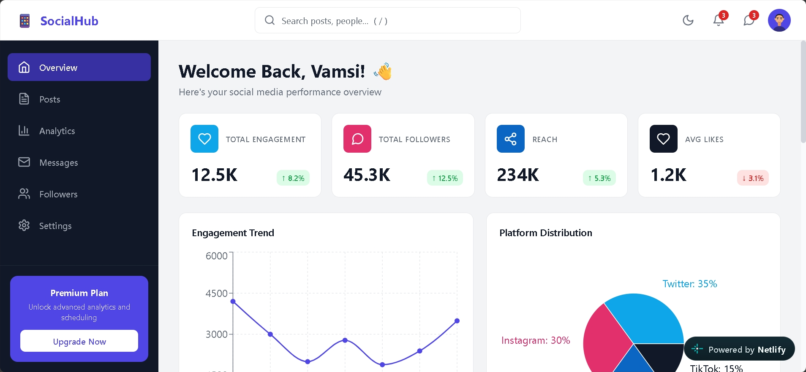
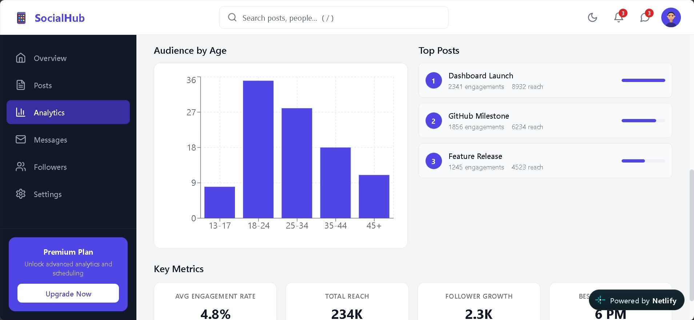

# 🌐 SocialHub

### A Social Media Dashboard Project

SocialHub is a frontend web development project built using React and Vite. It provides a dashboard-style user interface and demonstrates the basics of modern web development.

The main purpose of this project is to practice frontend development, build user interfaces, manage project dependencies, and deploy a website online.

🌍 **Live Demo:** https://socialhub23.netlify.app/

💻 **GitHub Repository:** https://github.com/vankayalavamsi/SocialHub

---

## 📸 Screenshots

### 📊 Dashboard



### 📈 Analytics



---

## ✨ Features

* Modern dashboard interface.
* Built using React components.
* Fast development environment using Vite.
* Icons using Lucide React.
* Charting support using Recharts.
* Responsive design where implemented.
* Deployed online using Netlify.

*Note: Features depend on the functionality implemented in the source code.*

---

## 🛠️ Technologies Used

| Technology   | Purpose                                                |
| ------------ | ------------------------------------------------------ |
| HTML5        | Structures the web page                                |
| CSS3         | Styles the application                                 |
| JavaScript   | Adds functionality and interactivity                   |
| React        | Builds reusable user interface components              |
| Vite         | Runs the development server and builds the application |
| Lucide React | Provides icons                                         |
| Recharts     | Creates charts and visualizations                      |
| Git          | Tracks code changes                                    |
| GitHub       | Stores and manages the source code                     |
| Netlify      | Hosts the live website                                 |

---

## 📂 Project Structure

```text
SocialHub/
│
├── public/
│   └── images/
│
├── screenshots/
│   ├── dashboard.png
│   └── analytics.png
│
├── src/
│   └── Application source code
│
├── index.html
├── package.json
├── package-lock.json
├── vite.config.js
└── README.md
```

### Folder Explanation

* `public/images/`: Stores public image assets.
* `screenshots/`: Contains the dashboard and analytics screenshots.
* `src/`: Contains the application source code and React components.
* `index.html`: Provides the main HTML page.
* `package.json`: Contains project dependencies and scripts.
* `package-lock.json`: Records dependency versions.
* `vite.config.js`: Contains the Vite configuration.
* `README.md`: Explains the project and how to run it.

---

## 📋 Requirements

Before running the project, install the following tools:

* **Node.js:** Runs the JavaScript development tools.
* **npm:** Installs and manages project dependencies.
* **Git:** Downloads the project and manages source code.
* **Code editor:** Visual Studio Code is recommended.
* **Web browser:** Chrome, Firefox, or another modern browser.

Download the tools:

* [Node.js](https://nodejs.org/)
* [Git](https://git-scm.com/)
* [Visual Studio Code](https://code.visualstudio.com/)

Check whether the tools are installed by running:

```bash
node -v
npm -v
git --version
```

If these commands display version numbers, the tools are ready to use.

---

## 📥 How to Clone the Project

Cloning means downloading a copy of the project from GitHub to your computer.

### Step 1: Open a Terminal

Open Command Prompt, PowerShell, Git Bash, or the terminal in Visual Studio Code.

### Step 2: Clone the Repository

Run the following command:

```bash
git clone https://github.com/vankayalavamsi/SocialHub.git
```

### Step 3: Open the Project Folder

```bash
cd SocialHub
```

You now have a local copy of the SocialHub project.

---

## 📦 How to Install Dependencies

Dependencies are the libraries and packages required by the application.

Inside the project folder, run:

```bash
npm install
```

This command reads `package.json` and installs the required packages.

Wait until the installation finishes.

---

## ▶️ How to Run the Project Locally

After installing the dependencies, start the development server:

```bash
npm run dev
```

Vite will display a local URL in your terminal, usually:

```text
http://localhost:5173/
```

Open the URL displayed in your terminal in a web browser.

You can now view and test SocialHub on your computer.

### How to Stop the Server

Press the following keys in your terminal:

```text
Ctrl + C
```

This stops the development server.

---

## 🏗️ How to Build the Project

To create an optimized production version of the application, run:

```bash
npm run build
```

Vite will compile and optimize the application.

After a successful build, the generated files will normally be stored in the `dist/` folder.

The `dist/` folder contains the files needed to deploy the application.

### Preview the Production Build

To preview the production build locally, run:

```bash
npm run preview
```

Open the URL displayed in the terminal.

**Note:** Run `npm run build` before previewing to ensure that the latest changes are included.

---

## 🌍 How to Deploy the Project on Netlify

Netlify is a hosting platform that allows you to publish your website online.

### Method 1: Deploy Using GitHub

This is the recommended method because Netlify can automatically deploy updates when you push changes to GitHub.

### Step 1: Open Netlify

Visit [Netlify](https://www.netlify.com/) and sign in or create an account.

### Step 2: Import Your Project

Choose the option to import an existing project and connect your GitHub account.

Select the `SocialHub` repository.

### Step 3: Configure the Build Settings

Use the following settings for this Vite project:

| Setting           | Value           |
| ----------------- | --------------- |
| Branch            | `main`          |
| Build command     | `npm run build` |
| Publish directory | `dist`          |

If your repository uses a different default branch, select that branch instead.

### Step 4: Deploy the Website

Click the deploy button.

Netlify will install the dependencies, build the application, and publish the generated files.

### Step 5: Open the Live Website

After deployment succeeds, Netlify will provide a public website URL.

You can share the URL with classmates, teachers, friends, or recruiters.

---

### Method 2: Manual Deployment

You can also deploy the project manually without connecting GitHub.

**Step 1:** Open a terminal inside the project folder.

**Step 2:** Install dependencies:

```bash
npm install
```

**Step 3:** Create the production build:

```bash
npm run build
```

**Step 4:** Open [Netlify](https://www.netlify.com/) and sign in.

**Step 5:** Use the manual deployment option to upload the generated `dist` folder, following the instructions in Netlify.

**Step 6:** Wait for deployment to finish and open the generated website URL.

---

## 🔄 How to Update the Live Website

If your GitHub repository is connected to Netlify, you can update your website by pushing new changes.

### Step 1: Make Changes

Edit the source code in your project folder.

### Step 2: Test the Application

```bash
npm run dev
```

Check whether the changes work correctly.

### Step 3: Build the Project

```bash
npm run build
```

Make sure the build finishes successfully.

### Step 4: Push Changes to GitHub

```bash
git add .
git commit -m "Update SocialHub"
git push origin main
```

### Step 5: Wait for Deployment

Netlify will normally start a new deployment automatically when it detects the changes.

After deployment succeeds, refresh your live website to see the updates.

---

## 🐛 Common Problems and Solutions

### 1. npm Command Not Found

**Problem:** The terminal does not recognize the `npm` command.

**Solution:**

* Install Node.js.
* Restart your terminal.
* Run `node -v` and `npm -v` again.

### 2. Dependencies Are Missing

**Problem:** The application cannot find a required package.

**Solution:**

```bash
npm install
```

Restart the development server afterward.

### 3. The Website Does Not Open Locally

**Problem:** The browser cannot open the application.

**Solution:**

* Make sure the development server is running.
* Check the URL displayed in the terminal.
* Check the terminal for errors.

### 4. The Production Build Fails

**Problem:** The `npm run build` command reports an error.

**Solution:**

* Read the error message carefully.
* Check the affected source file.
* Make sure the dependencies are installed.
* Fix the reported errors and run the build command again.

### 5. Netlify Deployment Fails

**Problem:** Netlify reports a failed deployment.

**Solution:**

* Check the deployment logs.
* Confirm the build command is `npm run build`.
* Confirm the publish directory is `dist`.
* Make sure the project builds successfully on your computer.

### 6. Screenshots Do Not Appear on GitHub

**Problem:** Images are missing from the README.

**Solution:**

* Make sure the image files are inside the `screenshots/` folder.
* Check that the filenames match the README paths.
* Commit and push the image files to GitHub.

---

## 🎓 Learning Outcomes

Through this project, I practiced:

* Building a frontend application using React.
* Understanding how Vite works.
* Using HTML, CSS, and JavaScript.
* Installing dependencies with npm.
* Organizing project files and components.
* Managing source code using Git and GitHub.
* Creating a production build.
* Deploying a website using Netlify.

---

## 🚀 Future Improvements

Possible improvements for future versions include:

* Improving the mobile-responsive design.
* Adding more interactive dashboard components.
* Enhancing accessibility.
* Adding more data visualizations.
* Connecting a backend API if dynamic data storage is required.
* Adding automated tests.

These are suggestions for future development and are not claims that the features are already implemented.

---

## 👨‍💻 Project Information

| Detail            | Information                                              |
| ----------------- | -------------------------------------------------------- |
| Project Name      | SocialHub                                                |
| Project Type      | Frontend Web Development                                 |
| Main Technology   | React                                                    |
| Build Tool        | Vite                                                     |
| Hosting Platform  | Netlify                                                  |
| GitHub Repository | [SocialHub](https://github.com/vankayalavamsi/SocialHub) |
| Live Website      | [SocialHub Live Demo](https://socialhub23.netlify.app/)  |

---

## 📄 License

Please check the repository for license information before redistributing or reusing this project.

---

⭐ If you find this project useful, consider giving the repository a star on GitHub.

**Thank you for checking out SocialHub!**
